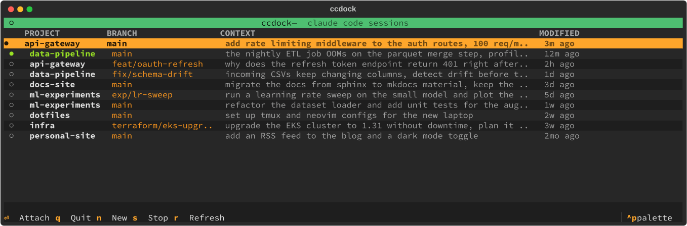

# ccdock: Claude Code Session Manager TUI

[](https://github.com/hkristen/ccdock/actions/workflows/test.yml)

If you run Claude Code on a remote server over SSH, you know the problem: sessions pile up across projects, you lose track of what's running, and reconnecting to the right one means digging through tmux windows or guessing PIDs.

ccdock gives you a single dashboard for all your Claude Code sessions. It shows which ones are alive, what they were working on, and lets you attach, create, or stop sessions with one keypress. Drop it in your `.bashrc` and it becomes your SSH landing screen.

Built with [Textual](https://github.com/Textualize/textual).

> Built for my own workflow; issues and pull requests welcome, no support guarantees. ccdock reads Claude Code's undocumented on-disk data and is tested with Claude Code 2.1.x on Linux, so a Claude Code update can break it at any time. It is an independent project, not affiliated with or endorsed by Anthropic.



## Install

You need Python 3.10+, [Claude Code](https://code.claude.com/docs) and tmux (for attaching to sessions; browsing works without it). Install ccdock with [uv](https://docs.astral.sh/uv/) or [pipx](https://pipx.pypa.io/), which both give it an isolated environment:

```bash
uv tool install git+https://github.com/hkristen/ccdock
# or
pipx install git+https://github.com/hkristen/ccdock
```

Then run `ccdock` (or `ccdock --help` first).

- **Neither uv nor pipx installed?** Get uv with `curl -LsSf https://astral.sh/uv/install.sh | sh`, or pipx from your package manager (`sudo apt install pipx`, `brew install pipx`).
- **`ccdock: command not found`?** The install directory (usually `~/.local/bin`) is not on your PATH. Run `uv tool update-shell` or `pipx ensurepath`, then open a new terminal.

| | uv | pipx |
|---|---|---|
| Update | `uv tool upgrade ccdock` | `pipx upgrade ccdock` |
| Uninstall | `uv tool uninstall ccdock` | `pipx uninstall ccdock` |

From a clone, `./install.sh` does the same with whichever of the two it finds.

## Usage

```
ccdock
```

### Key Bindings

| Key | Action |
|---|---|
| `j` / `↓` | Move down |
| `k` / `↑` | Move up |
| `Enter` | Attach, resume or start the selected session (see [Enter](#enter)) |
| `n` | Create new session (project picker) |
| `s` | Stop selected session (with confirmation) |
| `r` | Refresh session list |
| `q` | Quit |

### Enter

What `Enter` does depends on the session:

- **Running in tmux:** attach to it.
- **Running outside tmux:** after confirmation, stop it and resume it in tmux. Without a transcript this is not possible, and ccdock says so.
- **Stopped, with a transcript:** resume it in tmux.
- **Stopped, without a transcript:** start a fresh `claude` in the project directory.
- **Running on another machine** (cyan `◍`, see below): nothing; use it on that machine.

### Auto-launch on SSH Login

Add to your `~/.bashrc`:

```bash
if [[ $- == *i* ]] && [ -t 0 ] && [ -n "$SSH_CONNECTION" ] && [ -z "$TMUX" ] \
   && command -v ccdock &>/dev/null && [ -n "$(ls -A ~/.claude/projects 2>/dev/null)" ]; then
    ccdock
fi
```

The interactive and tty checks matter: bash also sources `.bashrc` for non-interactive SSH commands, so without them `scp`, `rsync`, and `ssh host cmd` would try to start the TUI. The last test only asks that `~/.claude/projects` exists and is not empty: ccdock lists resumable history as well as running processes, so it is worth opening even when nothing is running right now.

Attaching replaces the ccdock process with tmux, but bash carries on once tmux returns: when you detach, you land back in the login shell. If you would rather have the SSH connection close on detach, use `exec ccdock` in the snippet above (or on the command line) so the shell itself is replaced.

## How It Works

ccdock reads the `.jsonl` transcripts in `~/.claude/projects/*/` (and `sessions-index.json`, which older Claude Code versions wrote, when present) and cross-references with:

- `~/.claude/sessions/{PID}.json` for process IDs. With a home directory shared between machines (NFS), a file recorded by another machine marks its session as running there: ccdock shows it in cyan and will not resume or stop it, since a second `claude` on the same transcript would corrupt it. Claude Code deletes the file when it exits, so one left behind by a machine that crashed has to be deleted by hand.
- The process start time recorded there, compared against `/proc/{PID}/stat`, so a PID that has been reused by an unrelated process is not reported as a live session and cannot be stopped by mistake. Where that comparison is impossible (no `/proc`, or no recorded start time), a process only counts if its command name is `claude`.
- `tmux list-panes` for tmux session mapping. If tmux does not answer, ccdock says so and does not offer to restart running sessions until a refresh succeeds.

The CONTEXT column shows the session's title (one you set with `/rename`, else the one Claude Code generated), falling back to the first prompt. The project path and git branch come from the transcript (or the index), and the project path falls back to decoding the project directory name under `~/.claude/projects`. Sessions are sorted by most recently modified. Active sessions (green) have a live process; inactive ones (dim) do not.

The new-session picker (`n`) lists the projects of known sessions first, then the git repositories found in your home directory and in every directory under home that already holds a project with a session (so once one repo in `~/repos` has been used with Claude, the rest of `~/repos` shows up too). Set `CCDOCK_PROJECT_DIRS` to a colon-separated list of directories to search more places.

Resuming runs `claude --resume <session-id>` in a fresh tmux session in the project directory, so the conversation continues where it left off. A session running outside tmux cannot be attached to directly; ccdock sends it SIGTERM, waits up to ten seconds for it to exit, and only then resumes. It never force-kills: if the process does not exit, ccdock reports that and leaves it alone. Stop (`s`) works the same way: it sends SIGTERM, waits a few seconds for the process to exit, and leaves it alone with a message if it is still running.

## Development

Run the tests from a clone with `uv run --extra test pytest`, or in a virtual environment with `pip install -e '.[test]' && pytest`. They use a synthetic Claude data directory, a private tmux server and child processes of their own, so they never touch your real sessions.

Set `CCDOCK_CLAUDE_DIR` to point ccdock at a different Claude data directory, for example a synthetic one, without touching `~/.claude`. The demo above is recorded that way: `python3 scripts/record_demo.py` builds an invented user with invented projects and prompts (`scripts/demo_fixture.py`), backs two rows with processes in a private tmux server, drives the app headlessly, and writes `screenshots/demo.gif` and `screenshots/main-view.svg`. It needs tmux and ImageMagick on PATH and never reads your real sessions.

## Requirements

- Python 3.10+
- Claude Code (`claude` on PATH, for starting and resuming sessions); tested with 2.1.x
- tmux (optional, needed for attach/create, but session browsing works without it)
- git (optional, for the branch of sessions whose transcript does not record one)
- Linux is recommended: the start-time check needs `/proc`. Elsewhere ccdock falls back to checking that the process is named `claude`.

The Python dependencies (textual, rich) are installed automatically.

## License

MIT, see [LICENSE](LICENSE).
